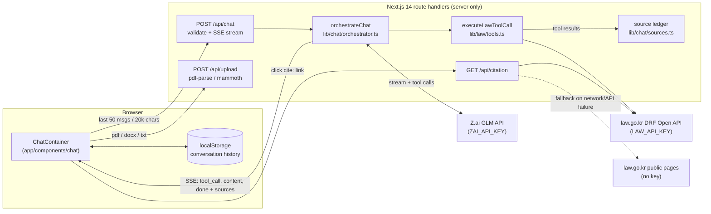

<div align="center">

# AI Law Counsel

**Korean legal-information chatbot that answers from statutes and precedents it has just fetched from the National Law Information Center (law.go.kr).**

[Live demo](https://ai-law-counsel.vercel.app) | [Architecture](docs/architecture.md) | [ADRs](docs/adr/) | [Report a bug](https://github.com/cskwork/ai-law-counsel/issues) | [Contributing](CONTRIBUTING.md)

</div>

---

## Problem

People facing a common legal problem (an unreturned lease deposit, an unfair dismissal, unpaid wages) need to know which law applies, what to do and by when, before they can afford a lawyer. A general chatbot answers from memory and can invent article numbers. This app makes the model look up the actual statute and precedent text first, links every citation to the official source, and states on every answer that it is legal information, not legal advice.

## Architecture



1. The browser sends the windowed conversation to `POST /api/chat`. The route validates it (`lib/chat/request-validation.ts`) and opens a Server-Sent Events stream (`lib/utils/sse.ts`).
2. `orchestrateChat` loops: call GLM with 6 legal tools plus `clarify_situation`, run the requested tools against law.go.kr, feed the results back. It stops after 8 rounds or 150 s of tool time, then forces one tool-free "write the final answer" turn.
3. Each tool result is recorded in a source ledger. When the answer is done, only sources that the answer actually cites *and* that a tool actually returned are sent as the "참조 출처" (sources) list.
4. Inline citations use a `cite:` link protocol (`[근로기준법 제23조](cite:statute/근로기준법/23)`). Clicking one calls `GET /api/citation`, which fetches the article text from the DRF API (falling back to the public law.go.kr page) and marks it verified or not.

Details, module map and failure handling: [docs/architecture.md](docs/architecture.md).

## Key technical decisions

- **Direct law.go.kr clients instead of the MCP server on the chat path.** The external korean-law-mcp service rejected new sessions under load, so tool calls now go straight to the DRF API with timeout, 2 attempts and 300 ms backoff (`lib/law/tools.ts`, `lib/law/client.ts`). See [ADR 0001](docs/adr/0001-direct-law-api-instead-of-mcp.md).
- **Grounding is enforced in code, not only in the prompt.** The source list is the intersection of "cited in the answer" and "returned by a tool this request" (`lib/chat/sources.ts`); a cited article that no tool returned does not appear there. Clicking any inline citation fetches the official text live from law.go.kr instead of trusting the model's wording. See [ADR 0002](docs/adr/0002-ground-citations-in-tool-results.md).
- **The loop always ends in a real answer.** Planning-only replies ("이제 조문을 조회하겠습니다") get one nudge, then a forced tool-free synthesis turn; degenerate repetition and answers over 16,000 characters are cut off (`lib/chat/orchestrator.ts`, `lib/chat/answer-guard.ts`). See [ADR 0003](docs/adr/0003-forced-final-synthesis-turn.md).
- **API keys never reach the browser.** `ZAI_API_KEY` and `LAW_API_KEY` are read only in server modules (`lib/zai/client.ts`, `lib/law/client.ts`); there are no `NEXT_PUBLIC_` variables, and the browser only talks to the app's own `/api/*` routes. The law.go.kr key travels as the `OC` query parameter on server-side requests only.
- **The client keeps state; the server is stateless.** History lives in `localStorage` (50 conversations, `app/hooks/useConversationHistory.ts`) and the client trims what it sends with `buildContextWindow` (`lib/chat/context-window.ts`); the server re-validates the same limits from `lib/constants.ts`.

## Features

- **Legal Q&A with tools**: `search_law_articles` (law.go.kr intelligent search, `target=aiSearch`), `search_law`, `get_law_detail`, `search_precedent`, `get_precedent_detail`, `search_administrative_rule`, plus `clarify_situation` for follow-up questions (`lib/law/tools.ts`, `lib/zai/tools-schema.ts`).
- **Search fallbacks**: a statute-name search with no hits retries with law-name words and intelligent search (`lib/law/search-law.ts`); a precedent search with no case-name hits retries in the judgment body (`lib/law/search-precedent.ts`).
- **Streaming**: token-by-token SSE, with a status board that names the tool being run, and a stop button that keeps the partial answer.
- **Document analysis**: upload PDF / DOCX / TXT up to 4.5 MB; extracted text (max 50,000 characters) is attached to the question for clause and risk review (`app/api/upload/route.ts`, `lib/document/`). Results are for reference only.
- **Document drafting**: the system prompt has a guided mode for 5 templates (lease, employment contract, demand letter, power of attorney, NDA) whose legal bases are listed in `lib/chat/template-types.ts`; drafts can be downloaded as text.
- **UI**: '민원 창구' (civil-service counter) design, statute / precedent / administrative-rule colour coding, conversation search, day/night theme, font size control (see [DESIGN.md](DESIGN.md)). A legal disclaimer ends every answer.

## Run locally

Requires Node.js 18+ (CI uses Node 22).

```bash
git clone https://github.com/cskwork/ai-law-counsel.git
cd ai-law-counsel
npm ci
cp .env.example .env.local   # fill in ZAI_API_KEY and LAW_API_KEY
npm run dev                  # http://localhost:3000
```

| Variable | Source | Required |
|----------|--------|----------|
| `ZAI_API_KEY` | [Z.ai](https://api.z.ai) | Yes, for chat answers |
| `LAW_API_KEY` | [open.law.go.kr](https://open.law.go.kr) (the `OC` parameter) | Yes, for tool calls and citation lookups |

Without keys the UI, upload parsing and request validation still work; chat requests return an error and statute/precedent citation lookups return 503.

## Testing

```bash
npm run lint          # ESLint (next/core-web-vitals + next/typescript)
npx tsc --noEmit      # type check
npm run test:run      # Vitest unit + integration
npm run build         # production build
npm run test:e2e      # Playwright E2E (starts `next dev` on port 3001)
```

Results on 2026-10-28 (macOS, Node 22.19.0, no API keys set):

| Suite | Command | Passed | Failed | Skipped |
|-------|---------|-------:|-------:|--------:|
| Vitest | `npm run test:run` | 291 (40 files) | 0 | 0 |
| Playwright (Chromium) | `npm run test:e2e` | 31 (3 files) | 0 | 0 |

Lint, `tsc --noEmit` and `npm run build` pass. The same commands run in [`.github/workflows/ci.yml`](.github/workflows/ci.yml) on every pull request and push to `main`.

Unit tests mock the GLM and law.go.kr HTTP calls, so they need no keys or network. The E2E suite exercises request validation, upload parsing, the UI shell and the no-key error paths; it does not call the live LLM.

Before this run, 3 of the 31 E2E tests failed without `LAW_API_KEY`: administrative-rule citations returned 503 even though they never call the API, and the config-error message no longer named the source. Fixed in `app/api/citation/route.ts`, covered by 2 new cases in `tests/app/api/citation.test.ts`.

## Limits

| Limit | Value | Where |
|-------|-------|-------|
| User message | 2,000 characters | `lib/constants.ts` |
| Conversation sent to the model | 50 messages / 20,000 characters (newest message always kept) | `lib/constants.ts`, `lib/chat/context-window.ts` |
| Upload | 4.5 MB; `pdf`, `docx`, `txt` | `lib/constants.ts` |
| Extracted document text | 50,000 characters | `lib/constants.ts` |
| Tool rounds per answer | 8 rounds, up to 6 tool calls each, 150 s tool budget | `lib/chat/orchestrator.ts` |
| law.go.kr request | 10 s timeout, 2 attempts, 300 ms backoff (4xx not retried) | `lib/law/client.ts` |
| `/api/chat` duration | `maxDuration = 300` s | `app/api/chat/route.ts` |

## Limitations and next steps

- Grounding is checked for the **sources list** and citation cards, not for every sentence: the model can still paraphrase a fetched article wrongly. There is no automated answer-quality evaluation.
- No authentication or rate limiting on `/api/chat`, so each request spends the deployer's Z.ai quota.
- `lib/mcp/` (MCP client and tool bridge, with tests) is no longer imported by any route since [ADR 0001](docs/adr/0001-direct-law-api-instead-of-mcp.md); `.github/workflows/keep-hf-space-awake.yml` still pings the Hugging Face MCP Space. Both can be removed if MCP is not coming back.
- A valid chat request with no `ZAI_API_KEY` returns HTTP 400 (with the variable name in the message) rather than a 5xx.
- Administrative-rule citations show a law.go.kr search link only; their full text is not fetched.

## Disclaimer

> This service provides AI-generated legal information, not legal advice. Always consult a licensed attorney for specific legal matters.

## Contributing and license

See [CONTRIBUTING.md](CONTRIBUTING.md). [MIT License](LICENSE) (c) 2026 cskwork.
