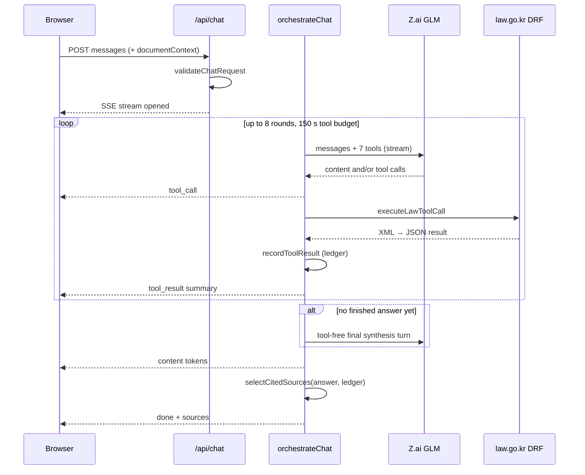

# Architecture

AI Law Counsel is a single Next.js 14 App Router application deployed to Vercel. The browser renders the chat UI and keeps conversation history; three server route handlers hold the API keys, talk to the LLM and to the National Law Information Center (law.go.kr), and stream results back.

## Components

| Component | Path | Responsibility |
|-----------|------|----------------|
| Chat UI | `app/page.tsx`, `app/components/chat/ChatContainer.tsx` | Sends the windowed conversation, reads the SSE stream, stop button (`AbortController`), renders answers and sources |
| Answer rendering | `app/components/chat/MessageBubble.tsx`, `CitationCard.tsx`, `SourcesFooter.tsx` | Markdown with `cite:` links, citation cards, the "참조 출처" list, text download for drafted documents |
| History | `app/hooks/useConversationHistory.ts` | `localStorage` key `law-counsel-conversations`, up to 50 conversations, trims on `QuotaExceededError` |
| Context window | `lib/chat/context-window.ts` | Newest suffix of the conversation within 50 messages / 20,000 characters |
| `POST /api/chat` | `app/api/chat/route.ts` | Validates input, attaches uploaded document text, runs the orchestrator, streams SSE (`maxDuration = 300`) |
| Request validation | `lib/chat/request-validation.ts`, `lib/constants.ts` | Message count and per-role length limits, document context checks |
| Orchestrator | `lib/chat/orchestrator.ts` | Tool-calling loop, planning nudge, forced final synthesis, repetition and length guards |
| Answer guard | `lib/chat/answer-guard.ts` | `isPlanningMessage`, `isDegenerateRepetition` |
| System prompt | `lib/chat/system-prompt.ts` | Today's date (Asia/Seoul), tool usage rules, answer sections, `cite:` format, document-analysis and template modes, disclaimer |
| Legal tools | `lib/law/tools.ts` | 6 tool schemas and `executeLawToolCall` dispatch |
| law.go.kr client | `lib/law/client.ts` and `lib/law/search-*.ts`, `get-*.ts` | DRF `lawSearch.do` / `lawService.do` URLs, XML parsing (`fast-xml-parser`), search fallbacks |
| Public-page fallback | `lib/law/get-public-law-article.ts` | Reads an article from the public law.go.kr page when the DRF API fails |
| Source ledger | `lib/chat/sources.ts` | Records what tools returned; selects the sources the answer cites |
| Citation URLs | `lib/citation/builder.ts` | law.go.kr deeplinks for statutes, precedents, rules |
| `GET /api/citation` | `app/api/citation/route.ts` | Full text for a clicked citation (`maxDuration = 15`, region `icn1`) |
| `POST /api/upload` | `app/api/upload/route.ts`, `lib/document/` | Type/size validation and text extraction with `pdf-parse` and `mammoth` |
| LLM client | `lib/zai/client.ts`, `lib/utils/zai-stream.ts` | Z.ai `glm-5.2` chat completions, streaming and non-streaming, SSE chunk parsing |
| Unused MCP client | `lib/mcp/` | Session-scoped korean-law-mcp client; not imported by any route since ADR 0001 |

## Data flow: one question

Details of the loop (`lib/chat/orchestrator.ts`):

- Each turn is streamed. Text is buffered until it reaches 280 characters with no tool call and does not look like a planning sentence; only then is it streamed live. Short preambles before tool calls are never shown.
- A turn with no tool calls and planning-only text gets one nudge (`MAX_PLANNING_NUDGES = 1`). If the loop ends without a finished answer (rounds, time budget or a second planning reply), a final turn without tools is forced with an instruction to use only what the tools returned.
- `clarify_situation` ends the request and shows the model's follow-up question to the user.
- At most 6 tool calls run per round. The final answer is cut at 16,000 characters or when the last 600 characters collapse to 3 or fewer distinct tokens.

## External dependencies

| Service | Used by | Auth |
|---------|---------|------|
| Z.ai chat completions (`api.z.ai`, model `glm-5.2`) | `lib/zai/client.ts` | `ZAI_API_KEY` as Bearer token, server only |
| law.go.kr DRF Open API (`/DRF/lawSearch.do`, `/DRF/lawService.do`) | `lib/law/client.ts` | `LAW_API_KEY` as `OC` query parameter, server only |
| law.go.kr public pages | `lib/law/get-public-law-article.ts` | none |

No database. Conversation history stays in the user's browser.

## Failure handling

| Failure | Behaviour | Where |
|---------|-----------|-------|
| Invalid request body | HTTP 400 JSON with a Korean message | `app/api/chat/route.ts`, `lib/chat/request-validation.ts` |
| law.go.kr network error, timeout, 5xx | Retried once after 300 ms; 10 s timeout per attempt; 4xx not retried | `lib/law/client.ts` |
| Tool throws | The error text becomes the tool result so the model can continue; summary shows "조회 실패" | `lib/chat/tool-executor.ts`, `lib/chat/orchestrator.ts` |
| Empty LLM response | SSE `error` then `done` | `lib/chat/orchestrator.ts` |
| Orchestrator throws mid-stream | SSE `error`, stream closed | `app/api/chat/route.ts` |
| Model never writes a final answer | Forced synthesis turn; if still empty, a fixed "please retry" notice | `lib/chat/orchestrator.ts` |
| Degenerate repetition / over-long answer | Stream cut with a notice | `lib/chat/orchestrator.ts`, `lib/chat/answer-guard.ts` |
| Citation lookup: DRF unreachable | Public-page fallback for statute articles; otherwise 200 with `verified: false` and a law.go.kr link | `app/api/citation/route.ts` |
| Citation lookup: `LAW_API_KEY` missing | 503 for statutes and precedents; administrative rules still return their link | `app/api/citation/route.ts` |
| `localStorage` full | Keeps the newest 80 % of conversations, else clears the key | `app/hooks/useConversationHistory.ts` |

## Tests

Vitest covers `lib/` and the route handlers with mocked HTTP (`tests/lib`, `tests/app`); Playwright covers validation, upload, the citation no-key paths and the home page (`tests/e2e`). CI: `.github/workflows/ci.yml`. Counts are in the README.

## Decisions

- [ADR 0001: Call law.go.kr directly instead of through the MCP server](adr/0001-direct-law-api-instead-of-mcp.md)
- [ADR 0002: Ground the source list in tool results](adr/0002-ground-citations-in-tool-results.md)
- [ADR 0003: Always end with a forced final synthesis turn](adr/0003-forced-final-synthesis-turn.md)
